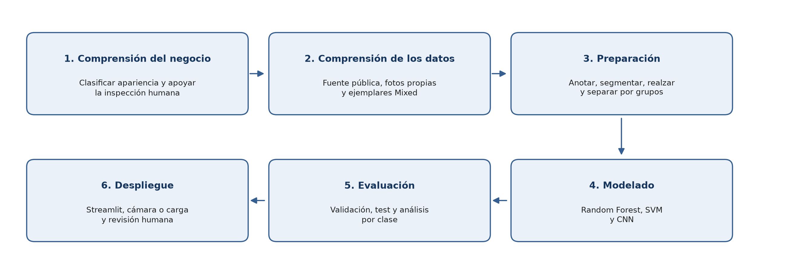
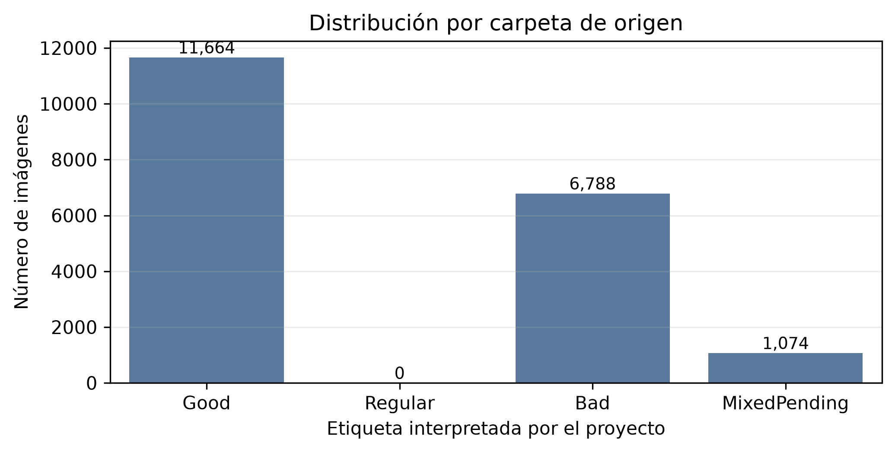

# Clasificación visual de calidad y tamaño relativo de frutas y verduras

**Proyecto:** APO3 MangoMelocotón  
**Curso:** Algoritmos y Programación III, semestre 2026-2  
**Fecha:** 24 de noviembre de 2026

**Resumen—** En este trabajo desarrollamos un prototipo para clasificar la calidad visual de frutas y verduras y estimar su tamaño relativo. Descargamos y auditamos Fruit Quality Classification: 19.526 imágenes JPG distribuidas en 11.664 Good, 6.788 Bad y 1.074 Mixed; OpenCV pudo leerlas todas y no encontramos duplicados exactos. Ejecutamos desde kernels limpios los cuadernos 01 y 02: preparamos 18.452 ejemplos Good/Bad en particiones 70/15/15, obtuvimos vectores de 108 características y generamos 1.318 recortes candidatos de las escenas Mixed. La fuente pública no incluye Regular, por lo que esa clase quedó sin ejemplos. Los resultados numéricos de modelos que conservamos corresponden a un piloto sintético previo, no a frutas reales. El tamaño se estima con el contorno mayor y aún requiere validación frente a medidas manuales.

**Palabras clave—** clasificación de frutas, visión por computador, CRISP-DM, Random Forest, SVM, CNN, Macro-F1.

## I. Introducción

La clasificación de frutas y verduras por tamaño y defectos visibles suele realizarse mediante inspección manual. El proceso puede variar entre evaluadores y afectar la selección, el empaque y el desperdicio de alimentos. En este trabajo buscamos apoyar esa inspección con un prototipo que recibe la fotografía de un producto individual, estima su calidad visual y calcula un tamaño relativo. Usamos la predicción como apoyo para la revisión humana: no la interpretamos como certificación de inocuidad ni como medición de madurez interna [1].

Nos propusimos resolver el problema mediante tres alternativas: Random Forest y SVM, que clasifican vectores de color, y una CNN, que aprende directamente de los píxeles. Organizamos el trabajo con CRISP-DM y ejecutamos los cuadernos 01 y 02 desde kernels limpios para explorar y preparar la descarga. Los cuadernos 03 y 04 ya contienen el flujo de entrenamiento y evaluación, pero aún no se han ejecutado con datos finales ni existen métricas de modelos entrenados con imágenes reales en el checkout actual. Identificamos por separado el piloto sintético previo y los resultados observados en los datos descargados.

## II. Fundamentos y formulación del problema

Representamos la calidad con tres etiquetas: Good, Regular y Bad. Para los modelos tradicionales, resumimos cada imagen en un vector de 108 características, xᵢ ∈ ℝ¹⁰⁸. El clasificador calcula una puntuación por etiqueta y seleccionamos la de mayor puntuación:

\[
\hat{y}_i = \arg\max_{k \in \{Good, Regular, Bad\}} f_{\theta,k}(x_i).
\]

La CNN recibe los píxeles y ajusta sus parámetros minimizando la entropía cruzada categórica dispersa:

\[
L(\theta) = -\frac{1}{N}\sum_{i=1}^{N}\log p_{i,y_i}.
\]

Calculamos exactitud como proporción de aciertos y Macro-F1 como el promedio del F1 de cada clase, para darles el mismo peso. También usamos exactitud balanceada, precisión y recall macro, AUC-ROC multiclase uno-contra-resto y matriz de confusión. Interpretamos estas métricas en conjunto: con pocos ejemplos, una exactitud global puede ocultar que el modelo falle por completo en alguna clase.

Para el tamaño no entrenamos un modelo con medidas físicas. Creamos una máscara de primer plano con saturación mayor que 30 y valor entre 25 y 250 en HSV; aplicamos apertura y cierre con un kernel de 5 × 5, descartamos contornos menores al 1 % del área y añadimos 10 píxeles de margen al recorte. Luego seleccionamos el contorno de mayor área y normalizamos su caja delimitadora:

\[
d_{norm}=\frac{\max(w_b,h_b)}{\max(W,H)}.
\]

Asignamos small si dₙₒᵣₘ < 0.35, medium si 0.35 ≤ dₙₒᵣₘ < 0.65 y large en otro caso. El valor depende del encuadre y representa tamaño relativo en píxeles; no equivale al diámetro real del producto.

## III. Metodología

### A. Diseño del flujo según CRISP-DM

La aplicación concreta de las fases del curso se resume en la Fig. 1 y la Tabla I. Las fases conectan la necesidad de inspección con el material de entrada, el tratamiento de las imágenes, la comparación de modelos y la presentación de predicciones.

| Fase CRISP-DM | Aplicación al problema | Salida de la fase |
| --- | --- | --- |
| Comprensión del negocio | Apoyar la clasificación visual y reducir variabilidad en inspección y empaque; la decisión final conserva revisión humana. | Objetivo: clasificar apariencia y estimar tamaño relativo. |
| Comprensión de los datos | Integrar Fruit Quality Classification, fotografías propias y, como enriquecimiento, ejemplares de imágenes Mixed. Examinar distribución, calidad y variabilidad. | Manifiesto con ruta, fuente, fruta, calidad, tamaño y grupo de origen. |
| Preparación | Etiquetar las fotos propias; segmentar frutas Mixed; limpiar, redimensionar y realzar contraste; separar grupos y extraer variables. | Imágenes de 128 × 128, etiquetas y vectores de 108 variables. |
| Modelado | Ajustar Random Forest y SVM con búsqueda en rejilla; entrenar una CNN pequeña con aumento de datos. | Modelos seleccionados con métricas de validación. |
| Evaluación | Seleccionar con validación; calcular métricas y matrices de confusión sobre test; revisar errores por clase. | Comparación experimental y límites de generalización. |
| Despliegue | Interfaz Streamlit para cargar o capturar una imagen y mostrar clase, confianza y tamaño relativo. | Prototipo de consulta; no equivale a una validación en operación. |

### B. Datos, anotación y preparación

Descargamos Fruit Quality Classification en `data/raw/kaggle`. El archivo contiene 19.526 JPG: 11.664 en `Good Quality_Fruits`, 6.788 en `Bad Quality_Fruits` y 1.074 en `Mixed Qualit_Fruits`; su CRC es válido y pudimos abrir cada imagen con OpenCV. La resolución más común es 256 × 256 (12.508 archivos); el resto incluye formatos rectangulares y tamaños mayores, por lo que conservamos las dimensiones originales en la exploración y redimensionamos solo al preparar las entradas del modelo. La distribución observada se resume en la Fig. 2.

La carpeta Mixed contiene escenas con frutas de distintas calidades. La usamos como fuente potencial de recortes que deberán revisarse y etiquetarse individualmente, no como sinónimo de Regular. El escáner del proyecto la separa como `MixedPending`, mientras que el clasificador espera las clases Good, Regular y Bad. Por tanto, debemos definir Regular con una guía de anotación y ejemplos revisados, en especial para las 30–50 fotografías propias que solicita el enunciado [1]. En el momento de esta revisión, `data/raw/collected` solo contiene el archivo marcador del repositorio y aún no aporta esas fotografías.

Para las imágenes Mixed, la segmentación convierte la escena a HSV, crea una máscara por saturación y brillo, aplica apertura y cierre morfológicos, descarta contornos pequeños y guarda cajas delimitadoras con margen. Antes de usar cada recorte debemos confirmar visualmente que corresponde a un solo producto y asignar calidad y tamaño con el mismo protocolo que usamos en las fotos propias. Los recortes de una imagen comparten `group_id`; mantenemos ese identificador al separar los datos para que partes de una misma escena no queden a la vez en entrenamiento y evaluación.

Cada ejemplo se redimensiona a 128 × 128 píxeles. El preprocesamiento aplica CLAHE (clip limit 2.0, mosaico de 8 × 8) al canal de luminancia en el espacio Lab. Random Forest y SVM reciben tres histogramas HSV normalizados de 32 bins cada uno (96 variables) y 12 estadísticas: media y desviación estándar de los canales RGB y HSV. Para la CNN, la imagen se convierte a RGB y se normaliza a [0,1]. Durante el entrenamiento se aplican rotaciones de hasta 20°, volteo horizontal, zoom de hasta 15 %, brillo entre 0.8 y 1.2, y desplazamientos de hasta 10 %.

La separación objetivo es 70 % entrenamiento, 15 % validación y 15 % prueba. Si hay varios recortes del mismo origen, separamos por grupos; además comprobamos los conteos por clase para que las particiones permitan evaluar todas las etiquetas. El código de entrenamiento configura validación cruzada estratificada con tres folds y optimiza Macro-F1; antes de entrenar debemos verificar que cada clase tenga suficientes ejemplos en train para esos folds. Reservamos el conjunto de prueba para una sola evaluación final.

### C. Modelos y protocolo de evaluación

Random Forest usa pesos de clase balanceados. La rejilla explora 100 o 200 árboles, profundidad sin límite, 20 o 40 niveles y un mínimo de 2 o 5 muestras para dividir un nodo. SVM normaliza las características y explora kernels lineal y RBF, C ∈ {0.1, 1, 10} y γ ∈ {scale, auto}, también con pesos balanceados. Ambos seleccionan hiperparámetros mediante validación cruzada y Macro-F1.

La CNN contiene tres bloques convolucionales de 32, 64 y 128 filtros, cada uno con normalización por lotes, max pooling y dropout de 0.25. Después de aplanar la representación, usa una capa densa de 256 unidades, dropout de 0.5 y una salida softmax. Se entrena con Adam, tasa de aprendizaje inicial 0.001, pesos por clase y callbacks de parada temprana, reducción de tasa y guardado del mejor modelo. La configuración ordinaria permite hasta 15 épocas; la prueba de humo de este informe se limitó deliberadamente a una época.

### D. Salidas directas de los cuadernos

En `01_data_exploration` mostramos conteos por clase y fruta, resolución, ejemplos, legibilidad y duplicados exactos: las 19.526 imágenes se leyeron y no hubo copias binarias repetidas. En `02_preprocessing` ejecutamos el pipeline y generamos `final_manifest.csv`, `train.csv`, `val.csv`, `test.csv`, `labelinfo.json`, `classweights.json` y las seis matrices `X*/y*` de 108 características en `data/processed`. Comprobamos sus formas, conteos por etiqueta y la ausencia de grupos compartidos entre particiones. El cuaderno también guardó 1.318 recortes Mixed en `data/processed/images/mixed_candidates/manifest.csv`, con la calidad vacía para revisión posterior. Los cuadernos 03 y 04 ahora implementan el entrenamiento, la búsqueda de hiperparámetros, la comparación y el análisis de errores; aún falta ejecutarlos con las imágenes y anotaciones finales.

## IV. Configuración experimental

Antes de volver al código remoto ejecutamos un piloto de integración con Python 3.11.14 y dependencias del proyecto. Generamos 36 imágenes sintéticas de 96 × 96 píxeles, 12 por etiqueta; no eran fotografías de Kaggle ni productos reales. El particionado produjo 25 ejemplos de entrenamiento, 5 de validación y 6 de prueba. La distribución fue Good/Regular/Bad = 8/8/9 en train, 2/2/1 en validation y 2/2/2 en test; las matrices de características midieron (25,108), (5,108) y (6,108). Esta corrida corresponde a la versión local previa al restablecimiento y se conserva únicamente como prueba preliminar, separada de la auditoría real del conjunto público.

Además de la comparación de modelos, se ejecutó una prueba separada de la ruta Mixed con una imagen sintética que contenía dos objetos. El segmentador produjo dos recortes, se completaron sus etiquetas y se volvió a generar el manifiesto. Esta fixture alcanzó 38 registros (13 Good, 13 Regular y 12 Bad); las particiones tuvieron 25, 7 y 6 ejemplos. Los dos recortes del mismo original quedaron juntos en validation.

## V. Resultados

En la auditoría verificamos 19.526 imágenes JPG legibles y cero duplicados binarios. Contamos 11.664 Good, 6.788 Bad y 1.074 Mixed. El documento base del proyecto registra 6.778 imágenes Bad; dejamos anotada esa diferencia de diez archivos para contrastarla con los metadatos de la fuente. El conjunto supervisado de esta descarga incluye Good y Bad; Regular tiene soporte cero y Mixed se mantiene pendiente.

La preparación del cuaderno 02 tardó aproximadamente 45 minutos con todas las imágenes. El manifiesto supervisado contiene 18.452 registros y generó 12.916 imágenes de entrenamiento, 2.768 de validación y 2.768 de prueba. La Tabla II muestra los conteos por clase. Las matrices de características midieron (12.916,108), (2.768,108) y (2.768,108), sin valores no finitos; no encontramos grupos compartidos entre particiones. El estimador asignó tamaño relativo large a 15.180 imágenes, medium a 1.943, small a 141 y unknown a 1.188; estas categorías aún no se comparan con medidas físicas. La segmentación procesó 1.074 escenas Mixed y produjo 1.318 recortes candidatos agrupados por imagen de origen, todos sin etiqueta de calidad.

| Clase o estado | Fuente pública | Entrenamiento | Validación | Prueba |
| --- | ---: | ---: | ---: | ---: |
| Good | 11.664 | 8.165 | 1.750 | 1.749 |
| Regular | 0 | 0 | 0 | 0 |
| Bad | 6.788 | 4.751 | 1.018 | 1.019 |
| Mixed pendiente | 1.074 | — | — | — |
| Total supervisado | 18.452 | 12.916 | 2.768 | 2.768 |

En el piloto sintético previo, Random Forest y SVM alcanzaron exactitud y Macro-F1 de 1.00 en validación y prueba; la CNN de una época alcanzó 0.40 y 0.19 en validación, y 0.33 y 0.17 en prueba. Estas métricas no describen el conjunto público. Aunque los cuadernos 03 y 04 ya están desarrollados, aún no se han ejecutado con datos finales; por ello, no reportamos resultados de entrenamiento real, evaluación final ni pruebas de la interfaz con esta descarga.

| Modelo | Exactitud val. | Macro-F1 val. | Exactitud test | Macro-F1 test | AUC-ROC test |
| --- | ---: | ---: | ---: | ---: | ---: |
| Random Forest | 1.00 | 1.00 | 1.00 | 1.00 | 1.00 |
| SVM | 1.00 | 1.00 | 1.00 | 1.00 | 1.00 |
| CNN (1 época) | 0.40 | 0.19 | 0.33 | 0.17 | 1.00 |

En test, Random Forest y SVM obtuvieron además exactitud balanceada, precisión macro y recall macro de 1.00. Sus matrices de confusión fueron diagonales, con dos aciertos por clase. La CNN tuvo exactitud balanceada de 0.33, precisión macro de 0.11 y recall macro de 0.33. La matriz de confusión, con filas como clase real y columnas como predicción en el orden Good, Regular y Bad, fue:

| Modelo | Matriz de confusión en test |
| --- | --- |
| Random Forest | [[2, 0, 0], [0, 2, 0], [0, 0, 2]] |
| SVM | [[2, 0, 0], [0, 2, 0], [0, 0, 2]] |
| CNN (1 época) | [[0, 2, 0], [0, 2, 0], [0, 2, 0]] |

La búsqueda seleccionó para Random Forest 100 árboles, profundidad ilimitada y `min_samples_split=2`; para SVM, kernel lineal, `C=0.1` y `gamma=scale`. Ambos alcanzaron Macro-F1 de validación cruzada de 1.00 en la fixture. La CNN predijo Regular para los seis elementos de test; su AUC-ROC uno-contra-resto fue 1.00, pese a su baja clasificación por argmax.

Como referencia de línea base, un clasificador constante que predice la clase más frecuente de entrenamiento (Bad, 9 de 25 ejemplos) alcanzaría exactitud 0.33 y Macro-F1 0.17 en este test equilibrado. La CNN igualó esas métricas agregadas, aunque predijo Regular para todos los casos. Por tanto, en esta prueba de una época no mostró ganancia sobre la línea base constante.

| Modelo | Clase | Precisión | Recall | F1 | Soporte |
| --- | --- | ---: | ---: | ---: | ---: |
| Random Forest | Good | 1.00 | 1.00 | 1.00 | 2 |
| Random Forest | Regular | 1.00 | 1.00 | 1.00 | 2 |
| Random Forest | Bad | 1.00 | 1.00 | 1.00 | 2 |
| SVM | Good | 1.00 | 1.00 | 1.00 | 2 |
| SVM | Regular | 1.00 | 1.00 | 1.00 | 2 |
| SVM | Bad | 1.00 | 1.00 | 1.00 | 2 |
| CNN (1 época) | Good | 0.00 | 0.00 | 0.00 | 2 |
| CNN (1 época) | Regular | 0.33 | 1.00 | 0.50 | 2 |
| CNN (1 época) | Bad | 0.00 | 0.00 | 0.00 | 2 |

## VI. Análisis y discusión

Los resultados de Random Forest, SVM y CNN que presentamos provienen del piloto sintético y no permiten concluir que algún modelo sea mejor para inspeccionar frutas. Los resultados reales de los cuadernos 01 y 02 describen composición, legibilidad y preparación: confirmamos el reparto 70/15/15 y la ausencia de grupos compartidos, pero todavía no medimos generalización de modelos. El soporte cero de Regular también impide interpretar una futura salida de tres clases hasta que el equipo incorpore ejemplos de esa etiqueta.

La CNN, entrenada por una sola época para reducir el tiempo de integración, asignó Regular a todos los ejemplos de test. Su Macro-F1 de 0.17 y la matriz de confusión muestran que no aprendió una regla de decisión útil en esta ejecución. El AUC de 1.00 evalúa el orden de puntuaciones por clase y no cambia el hecho de que el máximo de probabilidad fue Regular en todos los casos. Con seis imágenes, este AUC es inestable y no debe interpretarse como buen desempeño.

La segmentación real de escenas Mixed generó 1.318 recortes y conservó su procedencia. Esta salida comprueba que el flujo se ejecuta, pero aún debemos revisar cada recorte para evaluar su calidad y asignarle etiqueta. La fórmula de tamaño genera categorías relativas, pero no se contrastó con regla, balanza, calibre u otra medida de referencia. No comparamos las métricas sintéticas con estudios publicados porque la fixture y sus particiones no son comparables con conjuntos reales.

Desde la perspectiva ética y de impacto de la rúbrica [2], relacionamos los principales riesgos del caso con decisiones concretas de diseño. Los impactos se plantean como hipótesis que tendremos que medir en una prueba de campo; el piloto sintético no permite afirmar que ya redujimos pérdidas o desperdicio. La Tabla VI resume las medidas y principios que guiarán el uso del prototipo.

| Dimensión o dilema | Impacto potencial en el proyecto | Medida y principio asociado |
| --- | --- | --- |
| Privacidad y consentimiento | Una foto propia puede registrar personas, ubicación o datos EXIF que no necesitamos para clasificar el producto. | En la recolección futura evitaremos personas en el encuadre, quitaremos metadatos innecesarios, pediremos consentimiento y documentaremos el uso. Aplicamos respeto por la privacidad y manejo responsable de datos [3], [4]. |
| Sesgo y alcance global | Las seis frutas y los fondos de la fuente pública pueden representar de forma desigual variedades, regiones, iluminación y cámaras. El modelo podría generalizar peor a productos locales. | Mediremos resultados por fruta y fuente, ampliaremos la diversidad de captura y describiremos las condiciones cubiertas. Vinculamos estas decisiones con equidad, transparencia y evaluación de límites [3], [4]. |
| Impacto social | Una clasificación automática puede cambiar tareas de selección y desplazar decisiones de los operarios; errores poco explicados también reducen la confianza. | Mantendremos revisión humana, mostraremos la clase y confianza, y consultaremos a quienes usarían el sistema antes de proponer automatización. Priorizamos evitar daño y explicar las capacidades reales [3], [4]. |
| Impacto económico | Un falso Good puede dejar pasar un producto deteriorado; un falso Bad puede aumentar descarte o reducir el ingreso de quien lo produce. | Analizaremos errores por clase y el costo relativo de cada tipo de fallo. No usaremos la salida como certificación de inocuidad y evaluaremos el beneficio con datos de operación [1], [3]. |
| Impacto ambiental | Una mejor selección podría ayudar a reducir desperdicio; capturar, almacenar y entrenar imágenes también consume energía y recursos. | Reportaremos cualquier reducción solo si la medimos en un piloto de campo. Priorizaremos modelos y almacenamiento proporcionados al uso y registraremos el costo computacional [3], [4]. |

## VII. Conclusiones y trabajo futuro

Ejecutamos los cuadernos 01 y 02 con la descarga real: auditamos las imágenes, preparamos las particiones, comprobamos los vectores de características y generamos recortes Mixed pendientes. El piloto previo con imágenes sintéticas mostró aciertos de Random Forest y SVM y una CNN de una época que predijo Regular en todos los casos. Separamos ambos hallazgos y no presentamos el piloto como desempeño agrícola.

Para completar el experimento quedan la ejecución de los cuadernos 03 y 04 con datos finales, la revisión y anotación de recortes Mixed, la colección de 30–50 fotos propias y la aprobación de las clases y criterios de etiquetado. Después compararemos los tres modelos con validación, una línea base y un conjunto de prueba reservado; analizaremos errores por clase, fruta y fuente. También contrastaremos tamaño con medidas manuales y probaremos la interfaz. Esos resultados permitirán concluir sobre desempeño e impactos con evidencia.

## Referencias

[1] Universidad Icesi, “Proyecto final — Algoritmos y Programación III, semestre 2026-2,” secciones 1–7. Disponible: [`docs/project/0_Proyecto_Final_26-2.md`](project/0_Proyecto_Final_26-2.md).

[2] *Rúbrica del proyecto*, workbook suministrado por el equipo, “Rubrica_proyecto.xlsx,” 2026.

[3] Association for Computing Machinery, *ACM Code of Ethics and Professional Conduct*, 2018, doi: 10.1145/3274591. Disponible: <https://www.acm.org/binaries/content/assets/about/acm-code-of-ethics-booklet.pdf>.

[4] IEEE Publication Services and Products Board, *IEEE PSPB Operations Manual*, sec. 2.6.2, extracto de “IEEE Code of Ethics,” actualizado en junio de 2020, junio de 2021. Disponible: <https://proceedingsoftheieee.ieee.org/wp-content/uploads/2021/11/opsmanual.pdf>.

[5] R. D. Park, “Fruit Quality Classification,” Kaggle dataset. Disponible: <https://www.kaggle.com/datasets/ryandpark/fruit-quality-classification>.
